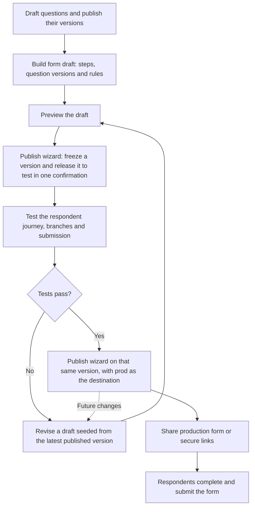

# Publishing and navigating the admin

Workflow: build and preview a **draft**, publish and release it to **test** in one
confirmation, verify it, then run the wizard again on that same version to release it
to **prod**. Authoring belongs to no environment, so nothing has to be switched to
publish. See the [implementation plan](../plan/form-publishing-workflow.md).

- Draft is the editable authoring state shared across environments. Only published
  versions can be released to test or prod; draft preview is available before release.
- Publishing freezes the draft as a version. Later edits start from the latest
  published version and leave released versions unchanged until a new release.
- Fixes produce a new form version, which goes through test again. If questions
  change, publish their new versions and update the form's pins before publishing.
- Promotion uses the exact tested version; it does not copy or republish the form.
- If production requires a second approver, someone other than the version's
  publisher performs the production release.
- Existing sessions finish on the version they started with. Rollback means
  releasing a previously published version to production.

Publishing and releasing both run through the publish wizard at
`/forms/{formId}/publish`, reached from the Publish entry on the form's Versions
screen. The wizard takes a source (the shared draft, or an existing version), the
destinations to release into, and one confirmation; it writes nothing before that
confirmation and then releases into every destination or into none of them. It lists
only the environments the operator may release this form into, and says why an
environment it cannot use is not eligible.

Where the site has a non-prod environment, production offers existing versions previously
released to any non-prod environment, plus previously deployed production versions for
rollback. A draft cannot be published straight into production, and this is a fixed floor
that no release-workflow configuration lifts. On a site whose only environment is
production, a draft publishes to production. The review step shows what freezes and, per
destination, the version that environment serves now and the version it will serve. A
test release does not itself prove that manual testing passed. The diagram assumes
the form is open in both environments. Draft editing belongs to no environment, so the
Operations selector never decides where a draft is released.

Planned, not shipped (agent builder, `plan/agent-builder-decisions.md` Q14 and Q16; tasks
113 and 115): publishing from the agent builder goes through this same wizard and no other
path.

- The wizard accepts a `returnTo` and goes back there when the operator leaves it. The
  server validates it against `/forms/<id>/build` for the same form only; an absolute or
  protocol-relative URL, another form's id, an encoded slash or any other path falls back
  to the form page.
- The builder's agent may open the wizard for a Publish forms holder, with no card since
  the wizard is the confirmation, and never publishes itself.
- The agent's draft edits take no card each, so the wizard shows the cumulative agent diff
  since the last human-reviewed revision: every change the agent made that no person has
  reviewed since, which the operator sees before confirming.

After a release, the Operations table is where a released form is operated, and it is the
only place those screens live. Its environment is the Operations header's own selector, and
each row offers the contexts the operator holds a read for on that form in that
environment: its Responses, its Links, its Webhooks and its Availability. A row offers no context
the operator's grants do not reach, so an account that may only read responses reaches the
response browser and nothing else about the form, and an account that may only erase
reaches no screen from the row at all. It offers no authoring screen either: the builder,
Rules, Preview, Versions and the publish wizard work on a draft that belongs to no
environment, while these screens are one environment's.

Availability is where a form is closed to new responses and reopened. Both the reading and the two
acts are the selected environment's, because the closed state is per form and environment:
closing production leaves a test run serving, and the confirmation names the environment it
is about before anything happens. The reading has three values, Open, Closed and Not Released,
the same three the Operations table and the Forms list use. A form with nothing released in the
selected environment reads Not Released and is offered neither verb, because there is nothing
there to close or reopen.

For Docker, set `QCMS_PORTAL_ENVIRONMENTS=test` in `.env` and recreate the portal
container to serve test links under `/test/`. The portal serves only prod when this
setting is empty.

## Navigating the admin

The application navigation offers Questions, Forms, Workspaces and Operations, and shows
only the areas your grants reach. Settings and My access are in the avatar menu; opening
either from inside Operations keeps you in Operations.

**Operations is the one area that has an environment.** It carries the environment
selector and an Exit control, and it is where a released form is operated. Every other
area works on shared authoring content and shows no environment. A link that leaves
Operations asks first, naming where it goes and saying the selected environment does not
apply there; Stay keeps you where you are and Exit Operations returns to the last place
outside Operations this tab visited. Moving inside Operations, including to its global
Delivery failures and Erasure log screens, asks nothing.

**Where you land depends on what you hold.** An account with only operational grants
lands in Operations and is offered no authoring menu; an account that only manages
workspaces lands in Workspaces. An address you may not open says so and offers a
permitted way on without naming the form or workspace behind it.

**Each area keeps one left rail.** Its top-level items stay visible and the current
item's own screens expand beneath it, two levels at most. Inside one form or question
the rail becomes that item's context: a link back to the list, the item's name and its
screens. The rail never repeats the page heading, and a breadcrumb line heads every
screen with the area, the section and the item.

The icon button at the start of the top bar, or `Alt+Shift+S` outside a text field,
collapses the rail to a narrow strip. The choice is remembered per viewer. Below the
sidebar breakpoint the rail is a disclosure named Menu instead, and the toggle steps
aside.

## Sources

- [Playwright draft-to-test-to-prod journey](../apps/admin/e2e/forms-promotion.pw.ts)
- [Playwright publishing journey](../apps/admin/e2e/forms-publish.pw.ts)
- [Production approval tests](../apps/admin/e2e/two-person-rule.pw.ts)
- [Shell areas, landing and exits](../apps/admin/e2e/shell-modes.pw.ts)
- [Leaving Operations](../apps/admin/e2e/operations-leave.pw.ts)
- [One top bar, the rail toggle and the breadcrumb](../apps/admin/e2e/shell-frame.pw.ts)
- [Deployment-origin links over the Docker stack](../apps/e2e/full-stack-conditional-form.pw.ts)
- [Publishing implementation](../apps/api/src/features/forms/README.md)
- [Releases and session versioning](../apps/api/src/features/releases/README.md)
- [Submission E2E test](../apps/api/e2e/01-full-loop.e2e.ts)
