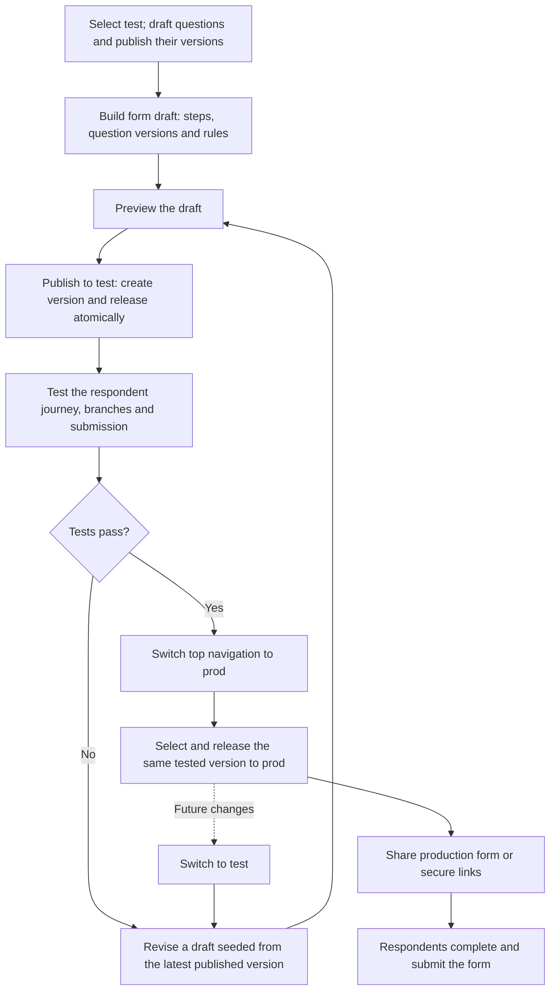

# Form publishing: test to production

Workflow: build and preview a **draft** in **test**, publish and release
it to test in one action, verify it, then switch to **prod** and release that same
version. See the [implementation plan](../plan/form-publishing-workflow.md).

- Draft is the editable authoring state shared across environments. Only published
  versions can be released to test or prod; draft preview is available before release.
- Publishing freezes the draft as a version. Later edits start from the latest
  published version and leave released versions unchanged until a new release.
- Fixes produce a new form version, which goes through test again. If questions
  change, publish their new versions and update the form's pins before publishing.
- Promotion uses the exact tested version; it does not copy or republish the form.
- If production requires a second approver, someone other than the version's
  publisher performs the production release.
- Existing sessions finish on the version they started with. Rollback means
  releasing a previously published version to production.

In the test/prod workflow, production offers existing versions previously
released to test, plus previously deployed production versions for rollback. Draft
editing and publishing are available in test. Release dialogs use the top navigation's
environment and have no target-environment selector. A test release does not itself
prove that manual testing passed. The diagram assumes intake is open in both environments.

For Docker, set `QCMS_PORTAL_ENVIRONMENTS=test` in `.env` and recreate the portal
container to serve test links under `/test/`. The portal serves only prod when this
setting is empty.

## Sources

- [Playwright draft-to-test-to-prod journey](../apps/admin/e2e/forms-promotion.pw.ts)
- [Playwright publishing journey](../apps/admin/e2e/forms-publish.pw.ts)
- [Production approval tests](../apps/admin/e2e/two-person-rule.pw.ts)
- [Publishing implementation](../apps/api/src/features/forms/README.md)
- [Releases and session versioning](../apps/api/src/features/releases/README.md)
- [Submission E2E test](../apps/api/e2e/01-full-loop.e2e.ts)
